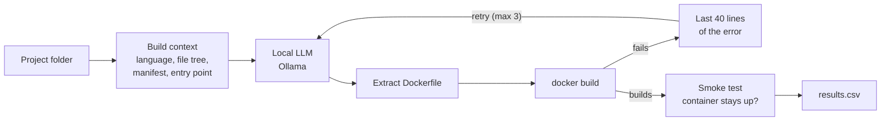

# Docker AI-Powered Generator

Python CLI that generates Dockerfiles with a local LLM (Ollama), builds them, and feeds build errors back to the model to self-correct. Benchmarked across model sizes and Python, Node and Go projects.

Example run:

```
$ python dockgen.py samples/python-flask --run
[1/3] asking qwen2.5-coder:3b ...
    model: 26.3s, 155 tokens, 8.2 tok/s
    building dockgen/python-flask:test ...
    build OK in 16.5s
    smoke test: container is running

Result: SUCCESS after 1 attempt(s)
Dockerfile: samples/python-flask/Dockerfile.generated
```

## How it works



1. **Read the project.** Detect the language from its manifest (`requirements.txt`, `package.json`, `go.mod`, ...), list the files, and read the manifest and the first 60 lines of the entry point, where the port and start command live.
2. **Ask the model.** Send that context with a system prompt that turns Docker best practices into rules: pinned slim base image, dependencies before source, multi-stage builds for compiled languages, non-root user, correct `EXPOSE` and `CMD`.
3. **Build it.** Keep only the Dockerfile from the reply, write it to `Dockerfile.generated` and run `docker build`.
4. **Self-correct.** If the build fails, send the end of the build log back into the same conversation and try again, up to 3 times.
5. **Smoke test** (`--run`). Start the container and check it is still running after 5 seconds. A Dockerfile can build and still be broken.

The model only ever sees text. Reading files, building, testing and retrying are all done by the script.

## Quick start

Requires Python 3.10+, [Docker](https://docs.docker.com/get-docker/) and [Ollama](https://ollama.com/download).

```bash
ollama pull qwen2.5-coder:3b

python -m venv .venv
source .venv/bin/activate        # Windows: .\.venv\Scripts\Activate.ps1
pip install -r requirements.txt

python dockgen.py samples/python-flask --run
```

| Option | Default | Purpose |
| --- | --- | --- |
| `project` | | Folder of the app to containerise |
| `--model` | `qwen2.5-coder:3b` | Any Ollama model |
| `--max-attempts` | `3` | Build tries before giving up |
| `--run` | off | Start the image and check it stays up |
| `--show-context` | off | Print exactly what the model sees, then stop |
| `--csv FILE` | off | Append a results row to a CSV file |

Set `OLLAMA_URL` to use an Ollama server on another machine. The tool writes `Dockerfile.generated` and never overwrites an existing `Dockerfile`.

## Sample projects

Three small apps to test against. Each contains a deliberate trap that models commonly fall into:

| Sample | Port | Trap |
| --- | --- | --- |
| `python-flask` | 5000 | Lists `gunicorn`: does the model use it, or Flask's development server? |
| `node-express` | 3000 | No `package-lock.json`, so `npm ci` fails |
| `go-api` | 8080 | No `go.sum`, so `COPY go.mod go.sum ./` fails |

## Design decisions

- **Local model.** Code never leaves the machine, there is no per-token cost, and it works offline. The trade-off is that speed and quality are capped by the hardware.
- **Low temperature (0.2).** Runs are repeatable, so models are compared on ability rather than luck.
- **Feed errors back in the same conversation.** The model sees its own last attempt next to the error, and only the last 40 lines are sent so the prompt stays inside the context window.
- **Review before use.** Output goes to `Dockerfile.generated`, never over your own `Dockerfile`, and nothing is deployed automatically. The build itself does run the model's instructions, as described under Safety.
- **Docker health is checked separately.** If Docker itself stops responding, the run stops with an error instead of blaming the model and recording a false failure.

## Safety

`docker build` executes the model's `RUN` lines on your machine, and models can invent files or packages. Only point the tool at your own projects, and read the generated file before using it anywhere that matters.

## Project structure

```
├── dockgen.py         # the CLI
├── requirements.txt   # one dependency: requests
└── samples/
    ├── python-flask/  # app.py + requirements.txt
    ├── node-express/  # server.js + package.json
    └── go-api/        # main.go + go.mod
```
