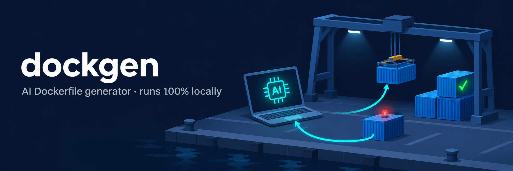
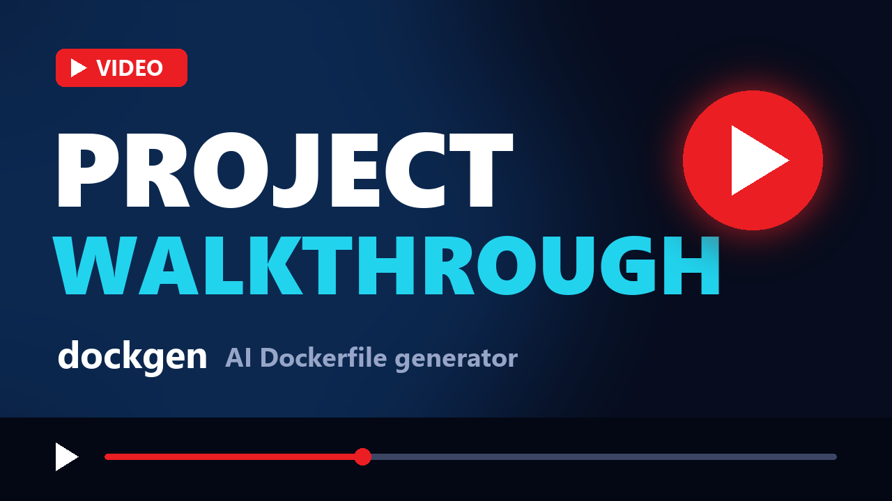
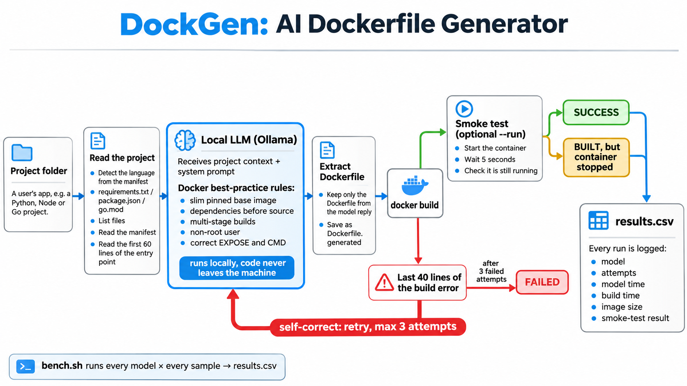
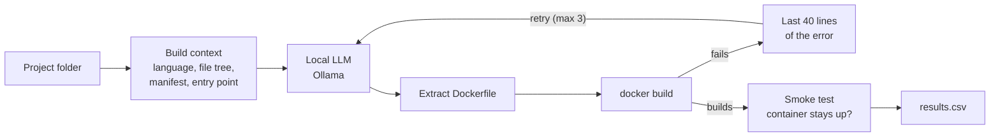

# Docker AI-Powered Generator

Python CLI that generates Dockerfiles with a local LLM (Ollama), builds them, and feeds build errors back to the model to self-correct. Benchmarked on Python, Node and Go projects.

## Demo

[](https://youtu.be/djjoB_iR1yk)

▶ **[Watch the project walkthrough on YouTube](https://youtu.be/djjoB_iR1yk)**

Example run:

```
$ python dockgen.py samples/python-flask --run
[1/3] asking qwen2.5-coder:3b ...
    model: 26.3s, 155 tokens, 8.2 tok/s
    building dockgen/python-flask:test ...
    build OK in 16.5s
    smoke test: container is running

Result: SUCCESS after 1 attempt(s)
Dockerfile: samples/python-flask/Dockerfile.generated
```

## How it works



<details>
<summary>Same flow as an editable Mermaid diagram</summary>



</details>

1. **Read the project.** Detect the language from its manifest (`requirements.txt`, `package.json`, `go.mod`, ...), list the files, and read the manifest and the first 60 lines of the entry point, where the port and start command live.
2. **Ask the model.** Send that context with a system prompt that turns Docker best practices into rules: pinned slim base image, dependencies before source, multi-stage builds for compiled languages, non-root user, correct `EXPOSE` and `CMD`.
3. **Build it.** Keep only the Dockerfile from the reply, write it to `Dockerfile.generated` and run `docker build`.
4. **Self-correct.** If the build fails, send the end of the build log back into the same conversation and try again, up to 3 times.
5. **Smoke test** (`--run`). Start the container and check it is still running after 5 seconds. A Dockerfile can build and still be broken.

The model only ever sees text. Reading files, building, testing and retrying are all done by the script.

## Quick start

Requires Python 3.10+, [Docker](https://docs.docker.com/get-docker/) and [Ollama](https://ollama.com/download).

```bash
ollama pull qwen2.5-coder:3b

python -m venv .venv
source .venv/bin/activate        # Windows: .\.venv\Scripts\Activate.ps1
pip install -r requirements.txt

python dockgen.py samples/python-flask --run
```

| Option | Default | Purpose |
| --- | --- | --- |
| `project` | | Folder of the app to containerise |
| `--model` | `qwen2.5-coder:3b` | Any Ollama model |
| `--max-attempts` | `3` | Build tries before giving up |
| `--run` | off | Start the image and check it stays up |
| `--show-context` | off | Print exactly what the model sees, then stop |
| `--csv FILE` | off | Append a results row to a CSV file |

Set `OLLAMA_URL` to use an Ollama server on another machine. The tool writes `Dockerfile.generated` and never overwrites an existing `Dockerfile`.

## Sample projects

Three small apps to test against. Each contains a deliberate trap that models commonly fall into:

| Sample | Port | Trap |
| --- | --- | --- |
| `python-flask` | 5000 | Lists `gunicorn`: does the model use it, or Flask's development server? |
| `node-express` | 3000 | No `package-lock.json`, so `npm ci` fails |
| `go-api` | 8080 | No `go.sum`, so `COPY go.mod go.sum ./` fails |

## Benchmark

`bench.sh` runs every model on every sample and writes one row per run to `results.csv`. It needs Bash (on Windows, Git Bash):

```bash
MODELS="qwen2.5-coder:3b" ./bench.sh
```

**Hardware:** AMD Ryzen 3 5300U, 7.3 GB RAM, integrated graphics, so inference runs on the CPU. Docker VM limited to 2 GB.

### Results

| Model | Sample | Built | Attempts | Model time (s) | Build time (s) | Image (MB) | Smoke test |
| --- | --- | --- | --- | --- | --- | --- | --- |
| qwen2.5-coder:3b | python-flask | ✅ | 1 | 26.4 | 4.0 | 49.2 | ❌ fail |
| qwen2.5-coder:3b | node-express | ✅ | 1 | 29.0 | 61.6 | 67.6 | ✅ pass |
| qwen2.5-coder:3b | go-api | ❌ | 3 | 96.6 | 14.1 | | skipped |

**1 of 3 samples fully working** with the 3B model.

- **Runs vary.** The example run at the top of this page passed on `python-flask`; this benchmark run of the same sample did not. Low temperature makes output more consistent, not identical, so each row is one run, not a guarantee.
- **Compare model times, not build times.** Build times include base-image downloads on first use and reuse cached layers afterwards.
- **Image size** is as reported by `docker image inspect`, which on Docker Desktop's containerd image store is the compressed size.
- **No 7B results.** `qwen2.5-coder:7b` needs about 5 GB of free memory to load. With Docker running, this machine had under 1 GB free, so the model could not be benchmarked here.

Graded against Docker best practices:

| Check | python-flask | node-express | go-api |
| --- | --- | --- | --- |
| Pinned base image | ✅ `python:3.10-slim` | ✅ `node:16-slim` | ✅ `golang:1.23-alpine` |
| Currently supported version | ❌ | ❌ | ❌ |
| Dependencies before source | ✅ | ✅ | ✅ |
| Multi-stage build | n/a | n/a | ❌ ships the compiler |
| Non-root user | ⚠️ `USER nonroot`, never created | ❌ | ❌ |
| Correct `EXPOSE` and `CMD` | ✅ uses `gunicorn` | ✅ | ✅ |

### What I learned

- **Context beats the prompt alone.** Asked "write a Dockerfile for a Flask app" with no context, the 3B model wrote a generic tutorial with an end-of-life Python version and Flask's development server. Given the real project, the same model used `gunicorn`, the correct port and dependency caching.
- **A small model can't use feedback it doesn't understand.** On `go-api`, the 3B model was shown `"/go.sum": not found` and kept `COPY go.mod go.sum ./` on all 3 attempts, in this run and in earlier ones. The retry loop only helps when the model can act on the error.
- **Building is not the same as working.** The Flask Dockerfile built cleanly but switched to a `nonroot` user it never created, so the container could not start. Without the smoke test this would have counted as a success.
- **Small models get the structure right and the details wrong.** The 3B model reliably ordered layers for caching and found the right port, but every base image was end of life, it skipped the multi-stage build for Go, and it never added a working non-root user, despite all three being in the rules.
- **Hardware sets the ceiling.** The 7B model could not allocate memory on 7.3 GB of RAM alongside Docker, and Docker itself crashed under memory pressure until its VM was capped at 2 GB.

## Design decisions

- **Local model.** Code never leaves the machine, there is no per-token cost, and it works offline. The trade-off is that speed and quality are capped by the hardware.
- **Low temperature (0.2).** Output is more consistent between runs, so models are compared on ability rather than luck. It is not fully deterministic, as the results show.
- **Feed errors back in the same conversation.** The model sees its own last attempt next to the error, and only the last 40 lines are sent so the prompt stays inside the context window.
- **Review before use.** Output goes to `Dockerfile.generated`, never over your own `Dockerfile`, and nothing is deployed automatically. The build itself does run the model's instructions, as described under Safety.
- **Docker health is checked separately.** If Docker itself stops responding, the run stops with an error instead of blaming the model and recording a false failure.

## Safety

`docker build` executes the model's `RUN` lines on your machine, and models can invent files or packages. Only point the tool at your own projects, and read the generated file before using it anywhere that matters.

## Project structure

```
├── dockgen.py         # the CLI
├── bench.sh           # every model × every sample → results.csv
├── requirements.txt   # one dependency: requests
└── samples/
    ├── python-flask/  # app.py + requirements.txt
    ├── node-express/  # server.js + package.json
    └── go-api/        # main.go + go.mod
```

## Next steps

- Benchmark larger models on a machine with more memory or a cloud GPU, and against a managed model API on cost, latency and quality.
- Lint with Hadolint inside the loop and send warnings back like build errors.
- Retry on smoke-test failure, sending the container logs back to the model.
- Generate a `.dockerignore` alongside the Dockerfile.
- Run the tool in GitHub Actions on pull requests.
